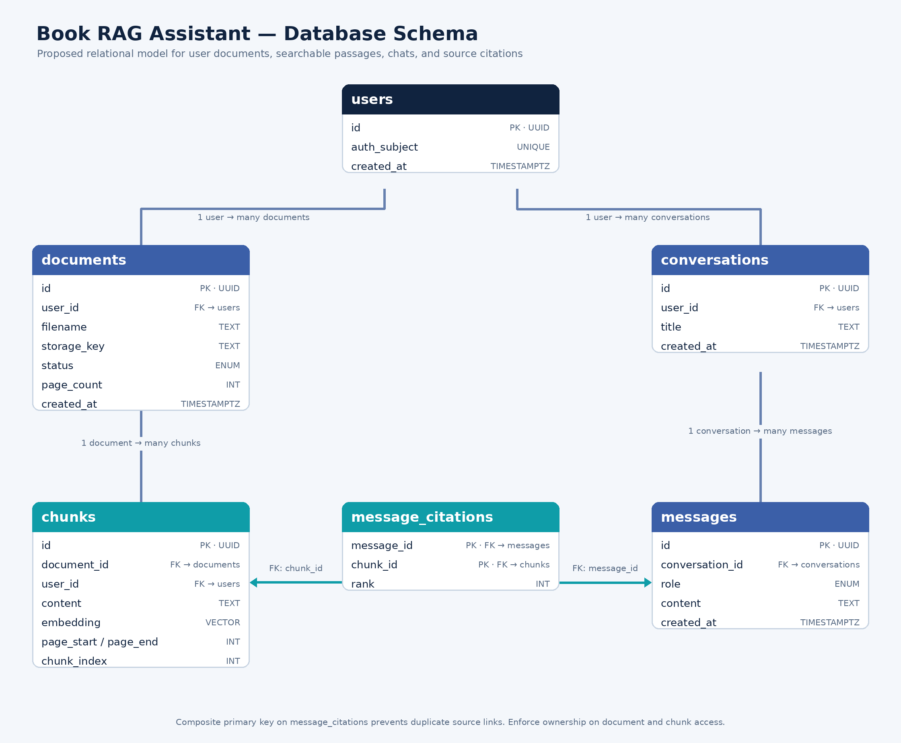

# Database Schema — Book-Based RAG Assistant

## Status

The diagram describes the original logical design. The actual Supabase schema is defined by migrations 0001–0004 in `supabase/migrations/`. Apply them in order. The implementation uses Supabase Auth, private Storage, 256-dimensional pgvector embeddings, and owner-scoped backend writes. Applying migrations to a hosted project is a separate setup step; this document does not execute SQL.

## Entity relationship diagram

## Tables

| Table | Main columns | Purpose |
| --- | --- | --- |
| `users` | `id` (PK), `auth_subject` (unique), `created_at` | Maps the identity provider's subject to the application's user record. |
| `documents` | `id` (PK), `user_id` (FK), `filename`, `storage_key`, `status`, `page_count`, `title`, `author`, `metadata_checked`, processing fields | Tracks the uploaded book, owner, index generation, and stated PDF metadata. |
| `chunks` | `id` (PK), `document_id` (FK), `user_id` (FK), `content`, `embedding`, `page_start`, `page_end`, `chunk_index` | Stores searchable text passages and the page metadata needed for citations. |
| `conversations` | `id` (PK), `user_id` (FK), `document_id` (FK), `title`, timestamps, active request lease | Groups a user's questions and answers about one selected book. |
| `messages` | `id` (PK), `conversation_id` (FK), `role`, `content`, `sequence_number`, `answer_status`, `answer_payload`, `created_at` | Stores ordered questions/answers and structured source snapshots. |
| `message_citations` | `id` (PK), `message_id` (FK), nullable `chunk_id` (FK), `document_id` (FK), `rank`, `source_kind`, filename, pages, excerpt, quote | Preserves verified evidence, including metadata sources, after reprocessing. |
| `chat_requests` | UUID `id` (PK), `user_id`, `document_id`, `conversation_id`, `processing_run_id`, `question`, `state`, `started_at`, `response` | Backend-only idempotency records and atomic turn state. |

## Phase 4 operational fields and tables

Migration 0005 adds file size, upload-completion reservations, processing attempt counts/due times, and leased deletion state to `documents`. A `deleting` row is hidden immediately by RLS while the worker retains the information needed to remove its private object. Deleting the row after object cleanup cascades its index and conversations. Incomplete uploads cannot be processed and expire into cleanup.

| Table | Purpose |
| --- | --- |
| `usage_windows` | Atomic per-owner/action minute and UTC-day counters shared across API instances |
| `usage_operations` | Same-day request UUID deduplication for daily usage budgets |
| `worker_heartbeats` | Freshness/state of independently running processing workers |

Operational tables have RLS enabled without browser policies. Their RPCs are service-only. API usage reads derive the owner from a verified token. Reservations and budget changes use database locks, and processing/deletion claims use row locks with unique lease IDs. Browser clients cannot call those maintenance functions or read another user's operational state.

## Relationships

- One user owns many documents.
- One document contains many chunks.
- One user owns many conversations.
- One conversation contains many messages.
- A message can cite many chunks, and a chunk can support many messages. `message_citations` represents this many-to-many relationship.
- A conversation is bound to one document; deleting that document cascades to its conversations, messages, citation snapshots, and request records.
- Citations use a UUID primary key and unique `(message_id, rank)`. A chunk can support multiple separate quoted claims in one answer. Reprocessing sets old citation `chunk_id` links to null while retaining their text/page snapshots.

## Data rules

- Use UUID primary keys for records exposed through application APIs.
- Make `users.auth_subject` unique so one external identity maps to one application user.
- Restrict document status to known values such as `queued`, `processing`, `ready`, and `failed`.
- Restrict message role to supported values such as `user` and `assistant`.
- Require `page_start` and `page_end` to be positive and `page_end >= page_start` when page metadata is available.
- Keep `chunk_index` unique within a document so chunks have stable order.
- Store one embedding per chunk. Its vector dimension must match the configured embedding model; record the model/version used so re-embedding can be managed deliberately.
- Keep generated answers separate from their citations. Build citation page numbers from chunk metadata rather than trusting page numbers generated by the language model.

## Indexes to plan

- B-tree index on `documents.user_id` and optionally `(user_id, status)` for the user's library and processing view.
- B-tree index on `chunks.document_id`, plus an ownership filter index suited to the selected query patterns.
- Vector index on `chunks.embedding` after choosing the distance metric and database scale. Benchmark the selected pgvector index method against the evaluation set before production.
- B-tree indexes on `conversations.user_id`, `messages.conversation_id`, and both foreign keys in `message_citations`.

## Access control and deletion

Every document, chunk, conversation, and message read must be scoped to the authenticated owner. Enforce this in API queries and database policies such as row-level security; a client-supplied ID alone is not proof of access.

Deleting a document deletes its chunks and conversations through database foreign keys. The API removes its private original file before deleting its database row. Coordinated cleanup retries and production retention policies remain Phase 4 work. Reprocessing retains existing conversation source snapshots even though it replaces the chunks.

## Implementation note

Migration 0003 adds processing leases, embedding identity, and owner/book/generation-scoped vector search. Migration 0004 adds metadata and chat persistence. `phase3_begin_turn`, `phase3_finish_turn`, and `phase3_abort_turn` are executable only by the backend service role. The API derives the owner from a verified access token; callers cannot supply their own owner ID.

The finish RPC locks the current book/conversation state, rejects changed processing generations and foreign chunks, verifies continuous supporting quotes, derives source pages from the stored chunk, and commits both messages with citations together. Completed request UUIDs return their saved response. Message ordering uses unique `(conversation_id, sequence_number)`, with paginated history reads.

Authenticated browser clients retain owner-scoped read policies for books, conversations, messages, and citation snapshots. Citation policies follow the conversation and document owner, so snapshots remain readable after old chunks are deleted. `chat_requests` has RLS enabled with no browser policies. The API exposes no arbitrary SQL interface or service key to the frontend.
