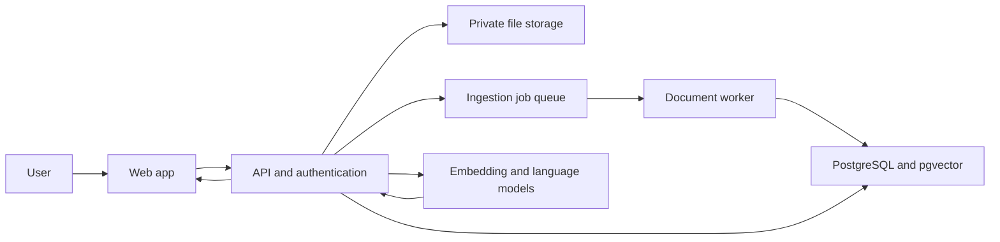

# High-Level Design — Book-Based RAG Assistant

## 1. Purpose and status

This document describes the proposed production architecture for the Book-Based RAG Assistant. It is a design plan; it does not claim that the components below are already implemented.

The application lets an authenticated user upload a book, ask questions about it, and receive answers supported by page-aware source citations.

## 2. Goals and first-release boundaries

- Process supported PDF books and preserve page information.
- Search only documents the signed-in user is allowed to access.
- Show citations linked to retrieved passages and say when evidence is insufficient.
- Make document-processing status and failures visible.
- Do not train or fine-tune a model for each uploaded book.
- Treat OCR for scanned PDFs as a later capability unless implementation needs require it.

## 3. Proposed architecture

A practical first version can use a Next.js web interface, a Python API, PostgreSQL with pgvector, private object storage, and a background worker. Providers should be chosen during implementation and configured through server-side environment variables.

| Component | Responsibility |
| --- | --- |
| Web application | Sign in, upload books, show processing status, ask questions, and display citations. |
| API | Authenticate requests, check document ownership, coordinate ingestion and question answering, and validate responses. |
| Private file storage | Store original uploads without making books publicly accessible. |
| Job queue and worker | Run extraction, chunking, and embedding outside the user-facing request; retry temporary failures and update status. |
| PostgreSQL and pgvector | Store document metadata, page-aware chunks, embeddings, conversations, and messages with ownership metadata. |
| Model services | Embed questions and chunks, then generate answers from retrieved passages. Keep provider calls behind an adapter. |

## 4. Book ingestion workflow

1. The user signs in and uploads a PDF.
2. The API checks authentication, file type, and size, creates a document record with status `queued`, stores the original file privately, and enqueues a job.
3. A worker extracts text page by page. If no usable text is found, it reports that OCR may be needed instead of indexing an empty document.
4. The worker splits text into overlapping chunks. Each chunk keeps its document ID, page number or range, and chunk order.
5. The worker creates embeddings and stores text, vectors, and metadata in PostgreSQL.
6. The worker marks the document `ready`. On failure, it stores a safe error and marks the document `failed`; eligible jobs can be retried.

Ingestion should be idempotent, so retrying a job does not create duplicate chunks.

## 5. Question-answering workflow

1. The API authenticates the user and checks access to the selected book or books.
2. It embeds the question and retrieves relevant chunks, filtered by ownership and selected document IDs.
3. It may combine vector search with keyword search and rerank candidates if evaluation shows a benefit.
4. It sends the question and retrieved passages to the language model with instructions to use the passages as evidence and to abstain when they are insufficient. Book text is treated as untrusted reference material, not as instructions.
5. The model returns an answer and references to retrieved chunk IDs. The API validates those IDs and builds citations from stored page metadata; it does not trust model-generated page numbers.
6. The API returns the answer and citations and stores conversation data according to the application's retention policy.

## 6. Data model

The logical schema has six tables: users, documents, chunks, conversations, messages, and message citations. The citation junction table connects each answer to the retrieved chunks that support it. See [DATABASE_SCHEMA.md](DATABASE_SCHEMA.md) for the full table design, constraints, indexes, and deletion behavior.

| Entity | Main relationship |
| --- | --- |
| users | Owns documents and conversations. |
| documents | Belongs to a user and contains page-aware chunks. |
| chunks | Belongs to a document and stores text, embedding, and page range. |
| conversations | Belongs to a user and contains messages. |
| messages | Belongs to a conversation and stores a user question or assistant answer. |
| message_citations | Joins messages to cited chunks using a composite primary key. |

The vector dimension must match the selected embedding model. Enforce ownership in API queries and database policies; a vector search must never bypass the ownership check.

## 7. Candidate API routes

These are design proposals, not implemented endpoints.

| Method and route | Purpose |
| --- | --- |
| `POST /api/documents` | Upload a PDF and enqueue ingestion. |
| `GET /api/documents` | List the authenticated user's documents. |
| `GET /api/documents/{id}` | Read status and metadata after checking ownership. |
| `DELETE /api/documents/{id}` | Remove the file, chunks, embeddings, and associated indexed content. |
| `POST /api/documents/{id}/retry` | Retry an eligible failed ingestion job. |
| `POST /api/chat` | Ask about explicitly selected accessible documents. |
| `GET /api/conversations/{id}` | Read a conversation after checking ownership. |

## 8. Reliability and scaling

- Keep ingestion asynchronous so large books do not hold an HTTP request open.
- Use bounded retries for temporary storage, database, and model-provider errors.
- Apply upload limits, request timeouts, rate limits, and per-user quotas.
- Track `queued`, `processing`, `ready`, and `failed` document states.
- Start with one database and a simple worker; add capacity when usage requires it.
- Back up the database and document a recovery process before handling important user documents.

## 9. Security and privacy

- Require authentication for uploads, search, conversations, and deletion.
- Enforce ownership in both API queries and database policies; never trust client-supplied IDs by themselves.
- Keep original files private and use short-lived access links only when required.
- Keep secrets on the server and out of source control.
- Test against prompt injection inside uploaded documents; retrieved book text must not override system instructions.
- Avoid logging full passages and personal data unless necessary and covered by a retention policy.
- Delete associated vectors and chunks when a document is deleted.
- Document retention and model-provider data handling before launch.

## 10. Quality evaluation

Maintain reviewed questions with expected supporting pages. Measure:

- **Retrieval recall at k:** whether supporting passages appear among the top results.
- **Citation correctness:** whether each cited page supports its answer claim.
- **Groundedness:** whether answer claims follow from the retrieved passages.
- **Abstention quality:** whether the system declines when the book lacks evidence.
- **Operational quality:** ingestion success rate, latency, and provider or storage errors.

Use this set to tune chunking, search settings, prompts, and any reranker. Fluent wording alone is not evidence of a correct answer.

## 11. Deployment outline

A first deployment can use managed hosting for the web app and API, managed PostgreSQL with pgvector, private object storage, and a background worker. Keep development and production environments separate, store secrets outside the repository, and apply database migrations deliberately. The worker must run somewhere that can reliably process queued jobs; request-only serverless functions may not suit long PDF jobs.

## 12. Decisions for implementation

1. Which authentication and private storage services fit the selected hosting?
2. Which PDF extractor preserves text and page metadata for the target books?
3. Which embedding and language model providers meet quality, privacy, and cost needs?
4. Which job mechanism fits expected file sizes and hosting limits?
5. What file size, page count, retention, and per-user usage limits should apply?
6. Should OCR be part of the first release or a later capability?
