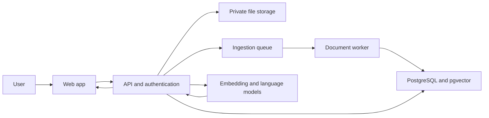

# Book-Based RAG Assistant

An AI study assistant that answers questions from books and learning documents. Upload a book, ask a question in natural language, and receive an answer grounded in retrieved passages with page citations so the reader can verify it.


## Problem

Readers often need a clear explanation or a specific fact from a long book. Searching manually takes time, while a general-purpose chatbot may answer from outside knowledge or invent details. This project aims to make book question answering useful and verifiable.

## Proposed solution

The application processes an uploaded PDF, extracts text and page metadata, divides it into searchable chunks, and indexes those chunks. For each question, it retrieves relevant passages and supplies them to a language model as context. The response cites the source pages and states when the book does not provide enough evidence to answer.

> This project uses Retrieval-Augmented Generation (RAG). It does not train or fine-tune a model on each uploaded book. The book is indexed for retrieval, then relevant passages are provided to the model at question time.

## Core user flow

1. Upload a PDF book or learning document.
2. See its processing status and, when ready, open it from a personal library.
3. Ask a question about one selected book or a chosen group of books.
4. Read an answer with page citations and supporting excerpts.
5. Open a citation to check the original passage.

## MVP features

- PDF upload with file validation and clear processing states
- Text extraction that preserves page numbers and document metadata
- Chunking, embedding, and semantic retrieval
- Answers grounded in retrieved passages
- Page citations and expandable source excerpts
- A clear “not found in the uploaded book” response when evidence is insufficient
- Private document library with delete controls

## Later features

- Chapter summaries, flashcards, and quizzes generated from cited passages
- Search across multiple selected books
- Hybrid search combining semantic and keyword matching
- Retrieval evaluation dashboard and feedback on answer quality
- Support for additional formats such as EPUB, subject to reliable text and page handling

## Proposed architecture

```text
Web application
    → API and document-processing pipeline
        → PDF text extraction with page metadata
        → chunking and embeddings
        → PostgreSQL with vector search
    → retrieval and answer generation
        → grounded answer with citations
```

One practical implementation is a Next.js interface, a Python API for ingestion and retrieval, and PostgreSQL with `pgvector` for document chunks and embeddings. The model and embedding provider should be configured through environment variables so they can be changed without changing the product flow.

## High-level design

The proposed system separates the web app, API, asynchronous document processing, private file storage, and retrieval services. Uploaded books are processed in a background worker. Questions retrieve page-aware passages, and the API validates citations before returning answers.



See [HIGH_LEVEL_DESIGN.md](HIGH_LEVEL_DESIGN.md) for ingestion and question workflows, data model, proposed API routes, security, reliability, deployment, and evaluation. This is the planned design; update it as implementation decisions are made.

## Database schema

The proposed schema stores users, books, page-aware chunks, conversations, messages, and the source links connecting answers to retrieved passages.


See [DATABASE_SCHEMA.md](DATABASE_SCHEMA.md) for table definitions, relationships, data rules, indexes, and ownership controls.

## Reliability and privacy goals

- Keep each user's documents and conversations isolated.
- Validate upload type and size; do not execute uploaded content.
- Store source name, page number, chunk position, and document ownership with each chunk.
- Return citations only for passages actually retrieved for the answer.
- Treat book text as untrusted input; it must not override application instructions.
- Provide deletion that removes the document and its indexed chunks.
- Measure retrieval quality and citation correctness with a small set of reviewed questions.

## Example questions

- “Explain the main idea of Chapter 3 in simple words.”
- “What does the author say about customer retention?”
- “Compare the two methods discussed in this book.”
- “Summarize Chapter 5 and cite the pages you used.”
- “Create five quiz questions from Chapter 2.”
- “Does this book explain concept X? If so, show me where.”

## Implementation phases

Build the project in this order:

1. **Secure foundation:** app scaffold, sign-in, database migrations, private PDF upload, and ownership policies.
2. **Ingestion and retrieval:** page-aware PDF extraction, chunking, embeddings, and user-filtered vector search.
3. **Grounded Q&A:** chat, source-verified citations, conversation history, and insufficient-evidence responses.
4. **Production and deployment:** background processing, retries, security review, quality evaluation, monitoring, and deployment.

See [ROADMAP.md](ROADMAP.md) for the implementation tasks and completion criteria for each phase.
## Phase 1 implementation

Phase 1 provides the starter application foundation:

- **Frontend:** Next.js App Router, React, and TypeScript. The landing page, sign-in/sign-up page, and protected library have distinct responsive layouts with glass surfaces, restrained motion, and reduced-motion support.
- **Backend:** FastAPI with Pydantic response models. The API verifies Supabase access tokens, lists and deletes only the signed-in user's books, and accepts PDF uploads up to 6 MiB.
- **Data and files:** Supabase Auth, PostgreSQL with Row Level Security, and a private PDF bucket. The browser uses only the publishable key; the secret key stays in the backend environment.
- **Upload interaction:** drag-and-drop and file picker, server-side type/size/signature validation, visible progress, and cubic-bezier book animation.

See [Phase 1 Setup](docs/PHASE_1_SETUP.md) for each Supabase and local setup step, and [Phase 1 Questions](docs/PHASE_1_QUESTIONS.md) for the technical and conceptual Q&A. Phase 1 stores uploaded PDFs; text extraction, indexing, and book Q&A arrive in later phases.

## Learning resource

See [`RAG_CONCEPTS_AND_INTERVIEW_QUESTIONS.md`](RAG_CONCEPTS_AND_INTERVIEW_QUESTIONS.md) for plain-language explanations of key RAG concepts and interview questions with sample answers.
